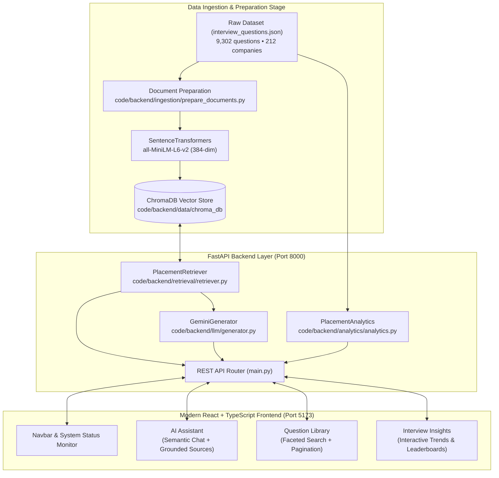

# Your AI Placement Assistant (UCS503P)

A Retrieval-Augmented Generation (RAG) system engineered for college campus placement preparation, grounded exclusively on **9,302 real interview questions** across **212 visiting companies** and **16 candidate interview experiences** from Thapar Institute drives (TietPrep dataset).

---

## 1. System Architecture



---

## 2. Core Capabilities & Application Pages

The application is structured into three dedicated views:

### 1. AI Assistant (`/`)
* **Semantic Vector Retrieval**: Queries are embedded into 384-dimensional dense vectors using `sentence-transformers/all-MiniLM-L6-v2` and matched against the ChromaDB index using cosine similarity.
* **Grounded LLM Generation**: Uses Google Gemini (`gemini-2.5-flash`) with a strict prompt instruction preventing hallucinations and attributing every answer directly to real questions.
* **Attributed Evidence Pills**: Each assistant answer includes expandable source pills showing exact verbatim questions, target companies, roles, batch years, and similarity scores.
* **Zero-Crash Local Mode**: If `GEMINI_API_KEY` is not configured, the assistant automatically switches to Local RAG Mode, surfacing all retrieved questions and metadata without error.

### 2. Question Library
* **Comprehensive Search**: Full-text and keyword search across all 9,302 placement questions (e.g. `HashMap`, `SQL`, `Binary Search`, `Thread`).
* **Faceted Filtering**: Filter dynamically by Company (212 companies), Role (27 roles), Batch (2026, 2027, 2028), and Category (`technical`, `hr`, `additional_practice`).
* **Actionable Cards**: One-click "Copy Question" with feedback, and "Ask AI About This" to jump directly into conversation context.
* **Deterministic Pagination**: Fast pagination with configurable page sizes (20, 50, 100 items).

### 3. Interview Insights & Analytics
* **High-Frequency Topic Radar**: Aggregated frequency metrics highlighting the most tested skills (SQL: 148 drives, Python: 115, Machine Learning: 94, DSA: 70, System Design: 63).
* **Company Hiring Volume**: Leaderboard of top visiting recruiters (American Express: 321 questions, Deloitte: 225, Blackrock: 146, IBM: 146, ProcDna: 138).
* **Category & Batch Distributions**: Visual breakdowns of questions by preparation category and graduation batch.
* **Senior Candidate Experiences**: Real verified interview tips and outcomes ("Offer received") from on-campus drives.
* **Interactive Navigation**: Clicking any company, topic, or category automatically opens the Question Library or AI Assistant pre-filtered to that selection.

---

## 3. Repository Structure

```text
AI-placement-assistant-rag/
├── code/
│   ├── backend/
│   │   ├── analytics/
│   │   │   ├── analytics.py           # In-memory aggregations & statistical insights
│   │   │   └── test_analytics.py      # Unit & live smoke tests for analytics
│   │   ├── data/
│   │   │   ├── chroma_db/             # Local ChromaDB persistent vector database (indexed)
│   │   │   └── raw/
│   │   │       ├── interview_questions.json    # 9,302 questions across 212 companies
│   │   │       └── interview_experiences.json  # 16 verified candidate experiences
│   │   ├── ingestion/
│   │   │   ├── prepare_documents.py   # Document transformation & metadata extraction
│   │   │   ├── test_prepare_documents.py
│   │   │   ├── embeddings.py          # SentenceTransformers (all-MiniLM-L6-v2) caching
│   │   │   ├── test_embeddings.py
│   │   │   ├── test_embeddings_smoke.py
│   │   │   ├── index_chroma.py        # Vector indexing pipeline for ChromaDB
│   │   │   └── test_index_chroma.py
│   │   ├── llm/
│   │   │   ├── generator.py           # Gemini 2.5 grounded RAG generation & fallbacks
│   │   │   └── test_generator.py      # Mocked and prompt verification tests
│   │   ├── retrieval/
│   │   │   ├── retriever.py           # Semantic search & comprehensive keyword filtering
│   │   │   └── test_retriever.py      # Unit tests for retrieval algorithms
│   │   ├── tests/
│   │   │   └── test_api.py            # Integration tests for FastAPI endpoints
│   │   └── main.py                    # FastAPI application & REST API routes
│   └── frontend/
│       ├── src/
│       │   ├── api/client.ts          # Typed REST API client
│       │   ├── components/
│       │   │   ├── Navbar.tsx         # Navigation header & live health monitors
│       │   │   ├── AIAssistant.tsx    # AI chat interface & source pill inspection
│       │   │   ├── QuestionLibrary.tsx# Question browser, faceted filters & pagination
│       │   │   └── AnalyticsDashboard.tsx # Visual insight charts & leaderboards
│       │   ├── types/index.ts         # TypeScript interfaces
│       │   ├── App.tsx                # Main view router & inter-page state
│       │   ├── index.css              # Dark obsidian theme (#0b0f17) stylesheet
│       │   └── main.tsx
│       ├── package.json
│       ├── tsconfig.json
│       └── vite.config.ts             # Vite configuration with API proxy to port 8000
├── pyproject.toml                     # Python dependencies & project metadata
├── .env.example                       # Environment configuration template
└── README.md
```

---

## 4. Getting Started

### Prerequisites
* Python 3.10+ (Tested on Python 3.13)
* Node.js 18+ and npm
* Git

### Step 1: Environment Setup

1. Clone or navigate to the repository:
   ```bash
   cd /Users/oshishmadhan/Documents/college-projects/AI-placement-assistant-rag
   ```

2. Activate the Python virtual environment:
   ```bash
   source .venv/bin/activate
   ```

3. Configure your environment file:
   ```bash
   cp .env.example .env
   ```
   *(Optional)* To enable full AI response generation via Gemini, add your API key to `.env`:
   ```bash
   GEMINI_API_KEY=your_gemini_api_key_here
   ```
   *If you do not have an API key, the system runs in 100% offline mode with full retrieval and source citations!*

---

### Step 2: Vector Database Ingestion (Already Complete)

The persistent ChromaDB vector store is pre-indexed with all **9,302 questions**. If you ever need to re-index the dataset from scratch:
```bash
python code/backend/ingestion/index_chroma.py
```
*Indexes all 9,302 questions across 73 batches in under 35 seconds.*

---

### Step 3: Run the Backend API

Start the FastAPI application on `http://localhost:8000`:
```bash
uvicorn code.backend.main:app --host 0.0.0.0 --port 8000 --reload
```

Verify backend health at:
`http://localhost:8000/api/health`
Interactive Swagger documentation is available at:
`http://localhost:8000/docs`

---

### Step 4: Run the Frontend UI

In a new terminal window:
```bash
cd code/frontend
npm install
npm run dev
```

Open your browser to:
**`http://localhost:5173`**

---

## 5. Verification & Test Suite

The project includes an automated test suite verifying every component from raw data preparation to API endpoints:

| Test Module | Command | Coverage |
| :--- | :--- | :--- |
| **Document Preparation** | `python code/backend/ingestion/test_prepare_documents.py` | 9 unit tests (schema validation, metadata flattening, ID generation) |
| **Embedding Module** | `python code/backend/ingestion/test_embeddings.py` | 10 unit tests (vector dimensions, batching, caching) |
| **ChromaDB Indexing** | `python code/backend/ingestion/test_index_chroma.py` | 5 unit tests (idempotency, collection creation) |
| **Retrieval Engine** | `python code/backend/retrieval/test_retriever.py` | 6 unit tests (semantic similarity, keyword search, pagination) |
| **LLM Answer Generation** | `python code/backend/llm/test_generator.py` | 3 unit tests (prompt grounding, fallback mode, key redaction) |
| **Analytics Engine** | `python code/backend/analytics/test_analytics.py` | 3 unit/smoke tests (topic distribution, company rankings) |
| **FastAPI Integration** | `python code/backend/tests/test_api.py` | 11 end-to-end integration tests (all REST endpoints) |

To run all tests in one go:
```bash
.venv/bin/python3 -m unittest discover -s code/backend -p "test_*.py"
```

---

## 6. Academic & Technical Highlights (UCS503P)

1. **Deterministic Document Identification**: Question IDs follow the format `{source_record_id}_q{index}` for 100% reproducibility across re-indexing runs.
2. **Strict Metadata Compliance**: Metadata in ChromaDB is strictly flattened into scalar primitives (`str`, `int`), avoiding indexing errors or un-indexed nested fields.
3. **Comprehensive Search Guarantee**: When users search for broad categories or concepts (e.g. "all HashMap questions"), the retrieval engine executes a full filtered scan rather than artificially truncating results to an arbitrary $top\_k$.
4. **Offline Resilience**: Question Library and Analytics are completely decoupled from external network access, functioning reliably without an active internet connection or external LLM service.
